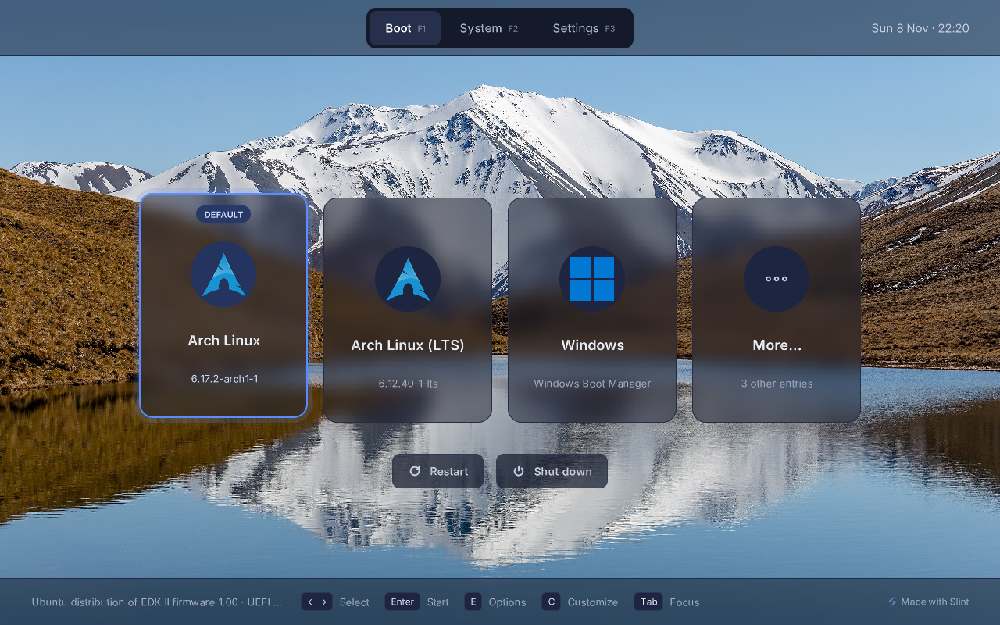
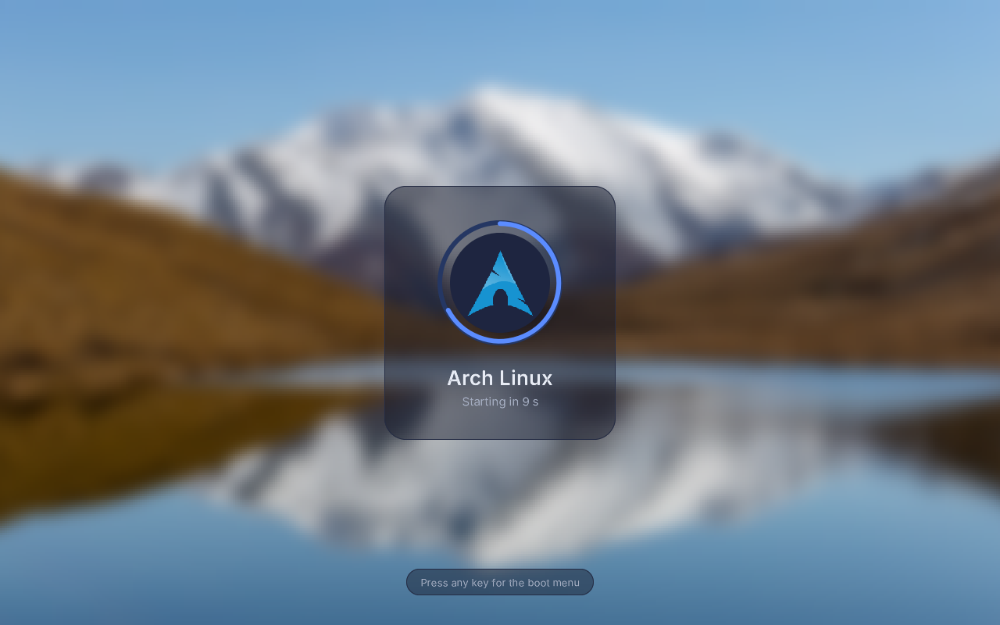
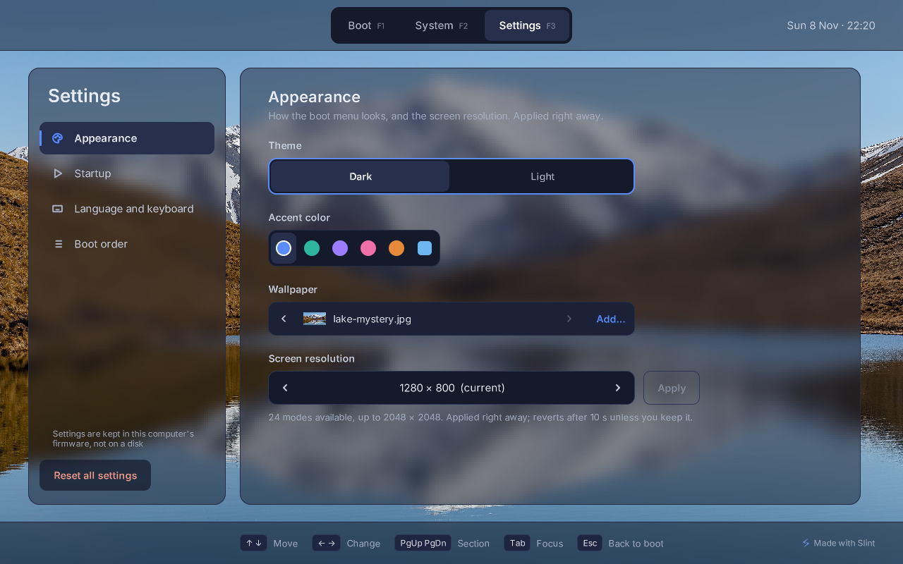
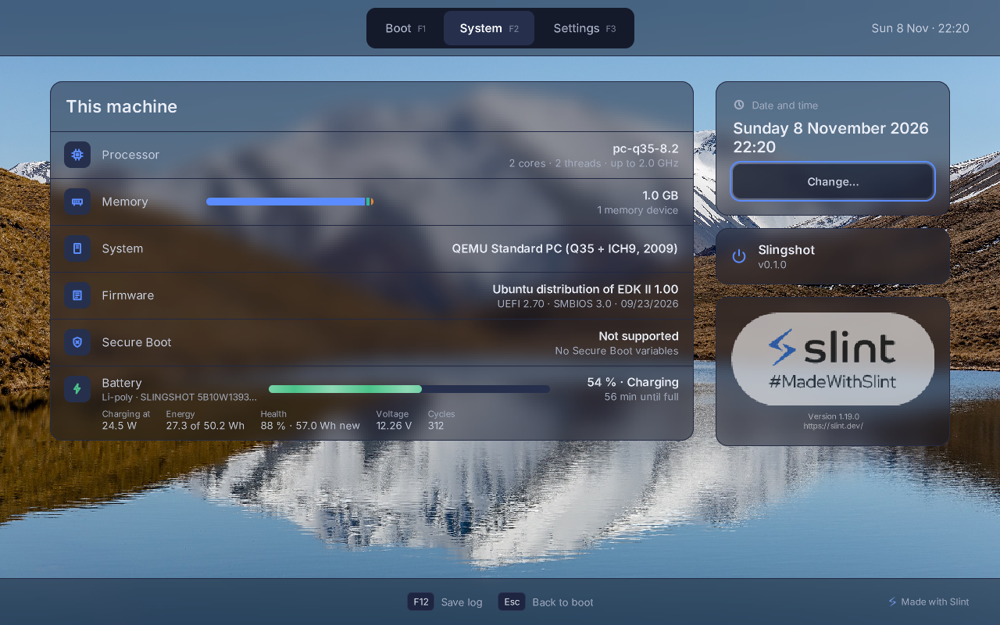
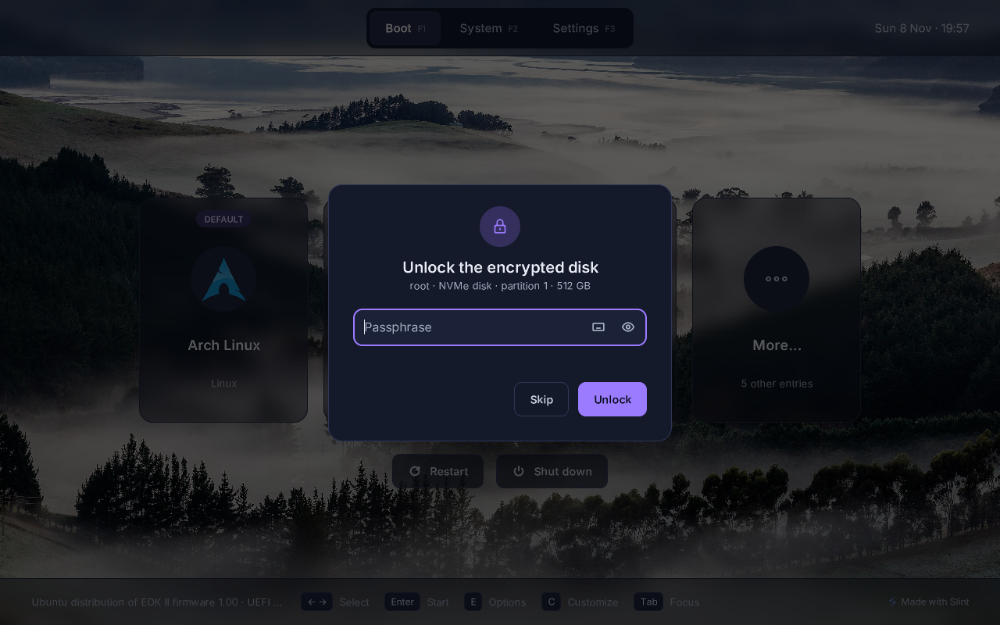

# Slingshot

A graphical boot menu for [UEFI](https://en.wikipedia.org/wiki/UEFI)
computers. Slingshot runs before your operating system and shows everything
your computer can start, Linux, Windows, macOS or a USB stick, as cards you
pick with the keyboard, a mouse, a touchpad or a touch screen. It's written in
[Rust](https://www.rust-lang.org) with [Slint](https://slint.dev), and runs
right on the firmware.

https://github.com/user-attachments/assets/e7206b0e-a50d-4cc1-a8d7-2d55f78f3529

- Unlocks LUKS2 encrypted disks before Linux starts, deriving the key from the passphrase only once
  ([setup](docs/encrypted-disks.md))
- Starts systemd-boot's entries itself; GRUB keeps working
- Finds Windows, macOS, Linux kernels and USB sticks, also when plugged in while the menu shows
- Settings and per-entry customization in the menu, or from Linux with `slingshot config`
- Dark and light themes, accent colors, wallpapers, splash screen
- Countdown to the default entry, or to the one used last
- Boot order, kernel options, firmware setup, Restart and Shut down
- Boot counting, resuming a hibernated Linux
- Secure Boot with shim
- System screen: hardware and battery
- Keyboard, mouse, touchpad and touch screen
- Localized, with keyboard layouts

<p>




</p>



## Install

On Linux, with a 64-bit PC (Intel or AMD) with UEFI firmware, and
[Rust](https://rustup.rs) to build it:

```sh
git clone https://github.com/ogoffart/slingshot-boot && cd slingshot-boot
scripts/slingshot-setup install        # build, copy to the EFI System Partition, add a boot entry
scripts/slingshot-setup try            # start Slingshot once, on the next restart
scripts/slingshot-setup make-default   # if you like it: start it on every boot
```

The script shows each command before running it, and asks before changing
anything; `scripts/slingshot-setup uninstall` removes it. With Secure Boot on, see [docs/secure-boot.md](docs/secure-boot.md).

systemd-boot and GRUB, Windows, Macs, 64-bit ARM, USB sticks, step by step:
[docs/install.md](docs/install.md).

## Configure

Change things where you see them: Settings and Customize at boot, or the same
screens from Linux with `slingshot config`. A `slingshot.toml` next to
Slingshot can also rename entries, move them under More… and lock the settings:
[docs/configuration.md](docs/configuration.md).

## License

GPL-3.0-or-later ([`LICENSE`](LICENSE)).
