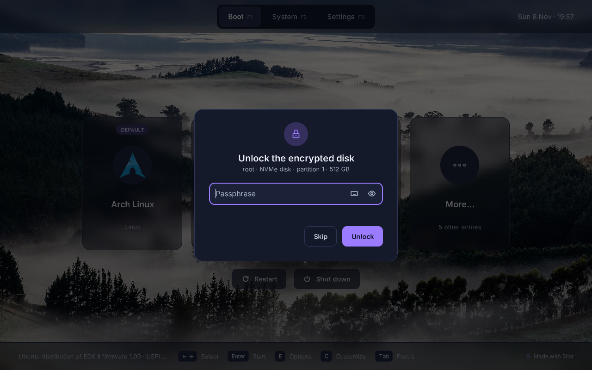

# Encrypted disks

When a Linux entry needs a LUKS2-encrypted disk, Slingshot asks for the passphrase in its own window, with your
keyboard layout. Linux then starts with the disk already unlocked, without asking again.

Slingshot hands the disk to Linux through one more initrd, built in memory. What it holds depends on your initrd:

- **With the `cryptsetup` program in it** (systemd-based initrds: mkinitcpio's `sd-encrypt`, dracut): the disk's key,
  so Linux opens the disk without deriving the key from the passphrase again.
- **Without it** (mkinitcpio's `encrypt` hook, or no `cryptsetup`): the passphrase, which Linux needs to check
  again, so the boot takes a couple of seconds longer.



## Setting it up

Slingshot asks for an entry when:

- It's a kernel with separate initrds, like a systemd-boot entry in `/loader/entries/` (`linux`, `initrd`, `options`
  lines). A [unified kernel image](#with-a-unified-kernel-image) or GRUB carries its own initrd, which asks as usual.
- Its kernel options name the disk: `rd.luks.name=` or `rd.luks.uuid=`, or `cryptdevice=` with `UUID=`, `PARTUUID=`
  or a device name like `/dev/nvme0n1p2`.
- The disk is LUKS2 with a passphrase, as cryptsetup makes it by default, and doesn't unlock with a TPM or security
  key (`systemd-cryptenroll`).
- The kernel is Linux 5.8 or later.

Not supported yet: initramfs-tools (Debian and Ubuntu's default), LUKS1.

Most systems with an encrypted disk already meet these, except for the unified kernel image. To check and set up:

1. **On Arch Linux (mkinitcpio),** run `sudo slingshot-setup luks-entry` (`slingshot-setup install` offers it too).
   If your system boots a unified kernel image, it adds a plain entry next to it and makes it Slingshot's default.
   If you use the `encrypt` hook, it offers to
   [switch to `sd-encrypt`](#faster-with-sd-encrypt-than-with-encrypt), which is faster. `slingshot-setup uninstall`
   takes it all back.
2. **For the fast way,** put `cryptsetup` in the initrd:
   - mkinitcpio with `sd-encrypt`: add `BINARIES+=(cryptsetup)` to `/etc/mkinitcpio.conf`, then
     `sudo mkinitcpio -P`.
   - dracut:

     ```sh
     echo 'install_items+=" /usr/sbin/cryptsetup "' | sudo tee /etc/dracut.conf.d/cryptsetup.conf
     sudo dracut --regenerate-all --force
     ```

3. **Restart and start the entry:** Slingshot asks for the passphrase.

The window types with the keyboard layout chosen in Settings (Language and keyboard), or the `keyboard` setting in
[slingshot.toml](configuration.md): your console's after `slingshot-setup install`. With several disks, Slingshot
asks for each, trying the previous passphrase first. **Skip** starts the entry without unlocking, and Linux asks
instead. Encrypted partitions are also listed in **Start a file…**: once unlocked, their files show read-only (with a
[file system driver](drivers.md) for ext4, btrfs…).

If Slingshot doesn't ask, press F12 on its System screen: the saved `slingshot.log` (next to `slingshot.efi`) lists
the entries and encrypted disks it found, and says what's missing. `rd.luks=0` in the kernel options turns it off for
an entry.

### With a unified kernel image

A unified kernel image carries its own initrd, so Slingshot can't add one. You can tell you have one when
`/etc/mkinitcpio.d/linux.preset` has an uncommented `default_uki=` line, or when `bootctl status` shows an entry like
`arch-linux.efi` and `/loader/entries/` is empty. To have Slingshot ask, add a plain entry next to it. With Secure
Boot, don't: that initrd isn't signed (see [Security](#security)).

`slingshot-setup luks-entry` does this with mkinitcpio. By hand:

1. In `/etc/mkinitcpio.d/linux.preset`, keep `default_uki=` and add `default_image="/boot/initramfs-linux.img"`, then
   run `sudo mkinitcpio -P` (`/boot` is the EFI System Partition here; use its mount point, such as `/efi`).
2. Write `/boot/loader/entries/arch.conf`, with the unified image's command line (`/etc/kernel/cmdline`) as
   `options`:

   ```
   title   Arch Linux
   linux   /vmlinuz-linux
   initrd  /initramfs-linux.img
   options rd.luks.name=…=root root=/dev/mapper/root rw
   ```

   If `HOOKS` in `/etc/mkinitcpio.conf` has no `microcode`, add `initrd /amd-ucode.img` or
   `initrd /intel-ucode.img` (whichever is in `/boot`) before the initramfs.
3. Restart and start "Arch Linux". To make it the default, use **Customize** on its card (C, or a right click).

Kernel updates keep both entries working. After changing `/etc/kernel/cmdline`, change the entry's `options` too.
With other tools, `kernel-install` writes such entries with `layout=bls` in `/etc/kernel/install.conf`.

### Faster with `sd-encrypt` than with `encrypt`

With the `encrypt` hook, Linux derives the key from the passphrase again, which pauses the boot as long as
Slingshot's check took. `sd-encrypt` opens the disk with the key at once. `slingshot-setup luks-entry` offers to
switch, keeping copies of the files it changes (`*.slingshot-setup.bak`). By hand:

1. In `HOOKS` in `/etc/mkinitcpio.conf`, `udev` becomes `systemd`, `keymap` and `consolefont` become `sd-vconsole`,
   and `encrypt` becomes `sd-encrypt`. Keep the other hooks: with LVM, `lvm2` stays after `sd-encrypt`.
2. In the kernel options, `cryptdevice=…:root` becomes `rd.luks.name=UUID=root`, with the LUKS volume's UUID
   (`sudo cryptsetup luksUUID /dev/nvme0n1p2`, with your encrypted partition: `lsblk -f` shows it). Keep
   `root=/dev/mapper/root`. Options such as `allow-discards` go in `rd.luks.options=` (`discard`).
3. Add `BINARIES+=(cryptsetup)` to `/etc/mkinitcpio.conf`, run `sudo mkinitcpio -P`, and check that it's there:
   `sudo lsinitcpio /boot/initramfs-linux.img | grep -E 'bin/cryptsetup$'`.

Every entry uses the new initramfs, a unified kernel image too. If a mistake keeps it from booting, unlock the disk
from an Arch USB stick, `arch-chroot` into it and fix the files. Once it works,
`journalctl -b -u slingshot-unlock-0.service` shows Slingshot's unit opening the disk.

The disk opens under the name the kernel options give (`rd.luks.name=UUID=root` makes `/dev/mapper/root`). If your
initrd's `/etc/crypttab` names it differently, use that name.

## Security

- **Memory only:** the passphrase and keys are never written to disk or to a firmware variable. Slingshot wipes its
  copies once they're in the extra initrd, or when you cancel, and wipes that initrd if the kernel can't start.
- **In Linux:** systemd empties the initrd's memory when it switches to the real system, and Slingshot's unit deletes
  the key file once the disk is open. While the disk is open, Linux keeps its key in memory, as with any disk
  encryption. Freed memory is only wiped with `init_on_free=1` in the kernel options (a little slower).
- **The EFI System Partition:** whoever can change its files can capture your passphrase, whatever program asks for
  it, because the initrd isn't signed and can be replaced. [Secure Boot](secure-boot.md) protects Slingshot and the
  kernel. To protect the initrd too, use signed unified kernel images, which ask for the passphrase themselves.
